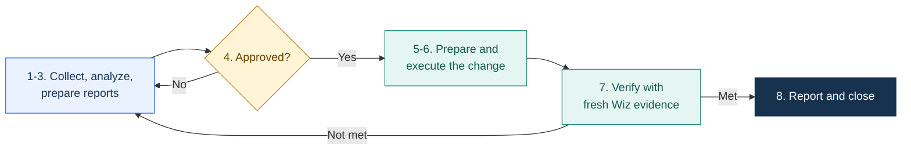

<div align="center">


# WizExpert

### Analyze. Report. Validate. Coordinate. Remediate.

**Evidence-led Wiz investigation, client reporting and approval-controlled remediation.**

**Wiz MCP** &nbsp; / &nbsp; **AWS + Azure** &nbsp; / &nbsp; **Assistant-led workflow**

[Setup](#setup) &nbsp; · &nbsp; [Use it](#use-it) &nbsp; · &nbsp;
[Governance reporting](#monthly-governance-reporting) &nbsp; · &nbsp;
[Security](#how-wizexpert-stays-secure) &nbsp; · &nbsp; [Guides](#guides)

</div>

---

WizExpert is an independent cloud security reporting and remediation assistant
for Wiz, not an official Wiz product. You describe a finding or reporting scope
to your approved assistant; it collects evidence through authorized Wiz MCP
tools, and this repository's local tools turn that evidence into reviewed
reports. **Nothing is changed, sent or published without a person approving it.**

> [!IMPORTANT]
> Wiz MCP runs in your assistant environment, not in this repository. Installing
> WizExpert does not create a Wiz connection or an unattended remediation service.

## What you get

| Deliverable | Purpose |
| :--- | :--- |
| **Risk explanation** | What Wiz found, why it matters and what the evidence supports |
| **Scoped assessment** | Affected resources, access paths, safeguards and evidence gaps |
| **Remediation plan** | Environment-aware options, prerequisites and approval requirements |
| **Excel report and stakeholder drafts** | Reviewed findings, recommendations and a clear decision request |
| **Progress and verification history** | Observation cutoffs, decisions, blockers and retained evidence |
| **Monthly governance reporting** | Per-client governance workbook, executive dashboard and governance-call deck |

## How it works



Investigation is read-only. Changes happen only within an approved scope, and a
finding closes only when fresh evidence shows the closure criteria are met.
ServiceNow stays authoritative for approvals, changes and exceptions. Details:
[workflow guide](docs/WORKFLOW.md).

## Setup

1. **Connect your approved assistant to Wiz MCP** with read-only permissions,
   following the [setup guide](docs/SETUP.md) (client SSO, VS Code MCP server,
   start/stop and authentication).
2. **Install the local tools** (Python 3.12+):

   ```powershell
   git clone https://github.com/PrashantAHD/WizExpert.git
   Set-Location .\WizExpert
   python -m venv .venv
   .\.venv\Scripts\python.exe -m pip install -e ".[governance]"   # omit [governance] if you don't need it
   .\.venv\Scripts\wizexpert.exe --help
   ```

3. **Verify access** by asking the assistant to list the read-only Wiz tools and
   run a small read-only query on your scope.
4. **Pick a private output folder outside this repository**, for example
   `C:\PrivateReports\<investigation>`.

## Use it

Give the assistant an issue/control ID or a precise scope, and the deliverables
you need:

> Investigate Wiz issue `<issue-id>` using read-only MCP tools. Explain the risk,
> identify affected resources and causes, and recommend remediation options.
> Prepare an Excel report and a stakeholder email draft in my private folder.
> Do not make changes or send the email.

> Prepare today's progress report for `<CVE-list>` in `<approved-scope>`. Use
> fresh Wiz evidence, keep previous observations and separate remaining from
> resolved findings. Do not send it.

These are assistant requests, not CLI commands. Recurring reports are run on
demand; nothing is scheduled automatically.

## Monthly governance reporting

**One tool, any client: each client's rules live in a private profile.**

```powershell
wizexpert governance setup      # once per client: name, snapshot day, baseline, logo
wizexpert governance monthly --month 2026-10 --input <csv...> `
  --previous-report <last workbook> --template <last dashboard> --output-dir <private folder>
```

| Command | Builds |
| --- | --- |
| `wizexpert governance monthly` | The month's workbook and executive dashboard, with backups |
| `wizexpert governance workbook` | The governance workbook on its own |
| `wizexpert governance dashboard` | The three-slide executive dashboard from a reviewed workbook |
| `wizexpert governance deck` | The ten-slide governance-call deck from a reviewed Wiz snapshot |

See the [governance guide](docs/GOVERNANCE.md).

## How WizExpert stays secure

Security is built into how the code is written, checked and released, not only
into how it is used.

**Every change is checked before it ships**

| Check | Runs | Catches |
| --- | --- | --- |
| Publication guard | Every push (local hook) and every CI run | Client names, account IDs, addresses, tokens and private files anywhere in tracked files or history |
| Automated tests (600+) | Every push and CI run | Regressions, including dedicated tests for each protection below |
| Bandit | Every push and CI run | Insecure Python patterns (static security analysis) |
| Ruff | Every push and CI run | Code errors and unsafe constructs |
| Dependency audit (`pip-audit`) | Every push (local hook) | Known vulnerabilities in installed packages |
| GitHub secret scanning and push protection | Every push to GitHub | Committed credentials |

CI runs with a read-only token, no secrets and GitHub actions pinned to exact
commits. Dependencies are kept minimal, version-bounded and raised to patched
releases when advisories appear; the governance extra is optional, so the core
install stays small. Changes reach `main` through pull requests with passing
checks.

**Protections in the tools themselves**

- **Hostile files:** workbooks are parsed with `defusedxml` and PowerPoint
  templates with entity resolution disabled, blocking XML entity attacks.
- **Formula injection:** imported values are written to Excel as plain text,
  and formula-like values in CSV exports are neutralised.
- **Safe file handling:** symlinked paths are refused, existing files are never
  silently overwritten, and replacements are staged, hash-checked and backed up.
- **Evidence integrity:** templates and prior reports are bound by SHA-256;
  counts, dates and totals are validated before anything is saved.
- **Private by design:** client names, evidence and reports never live in this
  repository; client rules come from a private profile.

Found a security issue? Report it privately to the maintainer rather than in a
public issue. Release checks: [publication guide](docs/PUBLICATION.md).

## Your responsibilities

- Keep reports, evidence, screenshots and approvals in approved private storage;
  local files are not encrypted by the tools.
- Never share credentials or unnecessary sensitive data with the assistant.
- Review every deliverable before sharing. Preparation does not authorize
  sending, ticket creation, status changes or cloud actions.
- AI analysis is not proof of compromise, and a Wiz resolution is not proof of
  a successful fix.

## Guides

| Guide | Covers |
| --- | --- |
| [Setup](docs/SETUP.md) | Wiz MCP connection, installation, migration from older versions |
| [Workflow](docs/WORKFLOW.md) | Evidence, analysis, communication and approval gates |
| [Execution follow-up](docs/EXECUTION.md) | Local-account evidence imports and blocker tracking |
| [Governance reporting](docs/GOVERNANCE.md) | Client profiles, workbook, dashboard and governance deck |
| [Governance snapshot](docs/GOVERNANCE-SNAPSHOT.md) | Read-only collection and schema for the governance deck |
| [Development and publication](docs/PUBLICATION.md) | Verification, dependencies and pre-push checks |

## Maintainer

<div align="center">

**[Prashant Kumar](https://github.com/PrashantAHD)** · Cloud Security Engineer @AHEAD

[GitHub](https://github.com/PrashantAHD) · [LinkedIn](https://www.linkedin.com/in/iprashantkr)

**Evidence before conclusions. Approval before changes. Verification before closure.**

</div>
