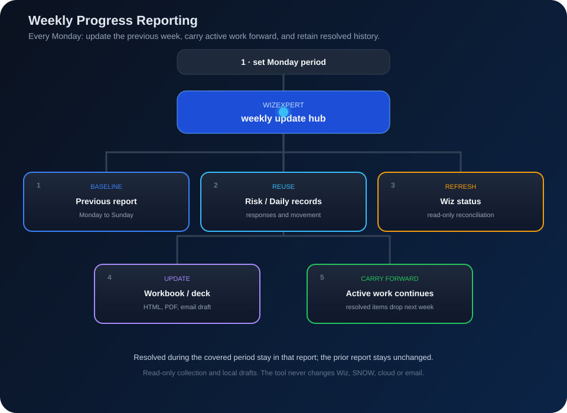

<div align="center">


**From Wiz evidence to review-ready security reporting.**

Investigate findings. Track remediation. Explain progress.
Read-only evidence in; validated local drafts out. People stay in control.


**[Watch the walkthrough](#see-it-in-action) · [Quick start](#quick-start) · [Workflows](#reporting-categories) · [Console](#workflow-console) · [Guides](#guides)**

</div>

## See it in action

<div align="center">

<a href="wizexpert/console/static/assets/console-demo.mp4"></a>

<p><b><a href="wizexpert/console/static/assets/console-demo.mp4">Watch the narrated walkthrough — 7:10 (MP4)</a></b></p>

<sub>Silent animated preview above · Full video: 1600 × 900, H.264/AAC, approximately 24 MB</sub>

</div>

Follow a guided workflow from an issue ID to validated local drafts:

- **Investigate:** start a Risk Issues run, follow evidence collection and see the QA checks.
- **Maintain:** compare Refresh with Update, review resolved cases and follow status Sync.
- **Report:** explore template and deliverable previews across all four reporting categories.
- **Stay in control:** tour the Dashboard and the read-only, no-send guardrails.

The demo uses fictional **Contoso** workflow data. It includes an animated tool intro,
the developer's authorized portrait and a silent closing credit:
**Developed by Prashant. — Cloud Security Engineer @AHEAD India.**

GitHub may open the MP4 as a repository file rather than an inline player. Use its
**Raw/Download** option if needed, or play the same video on the local console Home page,
with play/pause, seeking, skip controls and playback speed.

## Why WizExpert

WizExpert is an **independent reporting assistant for Wiz**, built for cloud security
engineers turning findings into actionable reports and recurring progress updates.
An authorized agent collects evidence through **Wiz MCP**; local tools build and
validate drafts using the workspace's reporting rules and approved templates.

| Reporting challenge | How WizExpert helps |
|---|---|
| Repeated portal-to-spreadsheet copying | Read-only collection with retained evidence and provenance |
| Inconsistent report formats | Defined deliverable slots, template builders and validators |
| Unclear changes since the last report | Refresh compares retained and current evidence and produces a change summary |
| Fragmented investigation history | Case and campaign workflows retain observations and previous deliverables |
| Drafts mistaken for approved communications | Local-only drafts, explicit QA and human-controlled release |
| Sensitive data entering source control | Private output storage, publication checks and CI safeguards |

> [!IMPORTANT]
> **WizExpert never sends email or changes Wiz, ServiceNow or cloud resources.**
> People approve release, send communications and perform remediation through their
> authorized processes. Workflow checks and tool approvals remain in force; a successful
> build is not release approval. Keep evidence, client templates and reports outside this repository.

## Quick start

### 1. Install the local tools

You need **Python 3.12+**, **Git**, and an organization-approved **VS Code / GitHub Copilot
agent-mode** setup. Live collection also requires authorized Wiz access.

```powershell
git clone https://github.com/PrashantAHD/WizExpert.git
Set-Location .\WizExpert
python -m venv .venv
.\.venv\Scripts\python.exe -m pip install -e ".[governance]"
.\.venv\Scripts\wizexpert.exe --help
```

Stop if a command fails. Use `-e .` instead if you do not need governance presentation
tools. Virtual-environment activation is not required.

### 2. Connect and verify Wiz access

1. Open the project in VS Code. [`.vscode/mcp.json`](.vscode/mcp.json) registers the
   workspace's Wiz MCP endpoint; it contains no credentials.
2. Sign in to your organization's SSO in the approved browser profile.
3. Run **MCP: List Servers → wiz → Start**, review trust prompts and complete Wiz sign-in
   with your own identity.
4. Ask the agent to confirm the available read-only tools and run a small, scoped query.
   A registered or running server alone does not prove access.

See the [setup guide](docs/SETUP.md) for authentication and environment requirements.
Never paste passwords, MFA codes or tokens into chat.

### 3. Prepare a private workspace and start a task

Choose approved output storage **outside the public checkout**. Production workflows need
your workspace's `WizExpert` agent, instructions, private templates and category bindings;
installing the CLI alone does not supply client-specific reporting configuration.

In the configured workspace, open a chat with the `WizExpert` agent and ask:

> Prepare today's progress report for `<CVE-list>` in `<approved-scope>`. Use the applicable
> collection and QA rules, retain previous observations, and separate remaining from resolved
> findings. Save drafts to `<private-output-folder>`. Do not send anything.

Prefer a visual entry point? Use the [workflow console](#workflow-console).

## Reporting categories

Every run selects one category and follows its fixed slots:
**category → deliverable slots → builder → validator → workflow QA/review**.

| Category | Purpose and outputs |
|---|---|
| **Risk Issues** | Investigate a rule or issue: internal analysis, client assessment, detailed and updated reports, stakeholder email drafts and Refresh change summaries |
| **Daily Progress** | Track a campaign: daily progress report, day-to-day movements, VM/CVE details and a stakeholder reply draft |
| **Weekly Progress** | Summarize current in-progress work and in-period resolutions: an editable slide deck, optional deck PDF and private email draft |
| **Monthly Governance** | Report a reviewed snapshot: governance workbook, operational slide deck and executive dashboard |

The [category definitions](docs/categories/README.md) describe the deliverable contracts.
Weekly reporting uses the slide deck as its primary output; the former workbook and
standalone report HTML are retired.

<details>
<summary><b>Category workflows (animated)</b></summary>



<sub>Daily Progress. Still open → collect again. Gate met → update and close.</sub>



<sub>Weekly Progress. Previous report → reuse records → refresh status → update → carry forward.</sub>



<sub>Monthly Governance. Cutoff → collect → draft → handoff → retain history → next month.</sub>

</details>

Category or template changes require a recorded owner request, a version bump,
template re-pinning and a QA rerun. See [Workflow QA](docs/WORKFLOW-QA.md) and
[Campaigns](docs/CAMPAIGNS.md).

## Risk Issues, in seven beats

1. **Collect:** query Wiz read-only and record evidence gaps.
2. **Draft:** build analysis, reports and email drafts in private storage.
3. **Communicate:** a person reviews and sends the package; the tool never sends.
4. **Approve:** record the response. Remediation continues below; risk acceptance skips to Update.
5. **Remediate:** coordinate the authorized fix outside WizExpert.
6. **Validate:** check fresh Wiz evidence; do not infer closure from a response alone.
7. **Update:** refresh the reports and drafts while preserving prior versions.

<details>
<summary><b>View the workflow diagram and email lifecycle</b></summary>



Open the SVG in a browser if GitHub displays a still frame.

| Draft | Purpose |
|---|---|
| Email-1: Initial stakeholder | Introduce the issue and proposed work |
| Email-2: Status update request | Ask for progress on the previous communication |
| Email-3: Refresh | Explain new findings and request confirmation or approval |
| Email-4: Follow-up response | Draft a reply to the stakeholder's response |

All four are template-based local drafts, never messages sent by the tool.

</details>

## Workflow console

A local frontend for the VS Code agent chat, not a separate automation engine.
It uses the workspace's existing agent, tools, instructions and approvals.

From the installed checkout, use the same virtual environment as above. Replace the
workspace example with the folder open in VS Code; `code.cmd` must be on your PATH.

```powershell
.\.venv\Scripts\wizexpert.exe console install-helper --code (Get-Command code.cmd).Source
```

Run **Developer: Reload Window** once after installing the helper, then start the console:

```powershell
.\.venv\Scripts\wizexpert.exe console --workspace "C:\path\to\your-workspace"
```

Open **http://127.0.0.1:8765/**. Follow any native VS Code approval prompts.
Pick a category, enter its input, press Start: the console opens a **new agent-mode chat** with
the `WizExpert` agent and mirrors it (progress, "input needed", summary, files).

| Feature | What it does |
|---|---|
| **Home walkthrough** | The narrated demo with play/pause, seeking, skip controls and playback speed |
| **Category cards** | Private case and campaign folders grouped by reporting category |
| **Refresh** | Read-only evidence refresh, delta, new snapshot, change summary including PDF, and rebuilt deliverables |
| **Update deliverables** | Apply the owner's requested edits to retained evidence without a Wiz fetch; archive previous outputs first |
| **Status Sync** | A visible status-check phase followed by sequential Refresh runs for changed cases |
| **Dashboard and notifications** | Operational summaries, recent runs and links to progress or input-needed states |
| **Completion checklist** | Per-run evidence of the workflow steps completed |
| **Resolved stage** | Resolved cases with rule title, rule ID and resolution notes |
| **Profile avatar** | Initials or an optional PNG/JPEG photo, stored outside the repository |

The console does not bypass workflow QA or VS Code tool approvals. Action-specific
requirements and troubleshooting are in the [console guide](docs/CONSOLE.md).

## Monthly governance

Client-specific rules live in **private profiles**, not in the public source code.
Reporting preserves prior snapshots and uses reviewed comparison sources and templates.

| Command | Builds |
|---|---|
| `governance setup` | A private client profile |
| `governance monthly` | Workbook + executive dashboard |
| `governance workbook` / `dashboard` / `deck` | Pieces on their own |
| `governance verify` | Read-only replay of the four-severity set |

These are `wizexpert` subcommands; use `--help` for their required inputs.
The `monthly` command builds the report pair, not the separate operational deck.
Follow the [governance runbook](docs/GOVERNANCE-RUNBOOK.md) for the complete workflow.
Automated verification does not replace release review.

## Guardrails worth knowing

- **Private by design:** keep real client identities, evidence, profiles, templates and reports outside this repository.
- **Individual authentication:** the MCP configuration holds the server endpoint, not credentials; each operator uses their own authorized identity.
- **Evidence before conclusions:** collection checks gate generation; gaps and conflicting evidence must stay visible.
- **Controlled local updates:** retain evidence, archive previous deliverables and pin templates with SHA-256.
- **Human-controlled release:** review every output. AI analysis is not proof of compromise; a Wiz resolution is not proof of a successful fix.
- **Publication safeguards:** follow the repository's verification and PR process before publishing code; never publish private evidence.
- Found a security issue? Report it privately to the maintainer.

## Guides

| Guide | Covers |
|---|---|
| [Setup](docs/SETUP.md) | Wiz MCP sign-in, install |
| [Category definitions](docs/categories/README.md) | Deliverable slots, bindings and category contracts |
| [Workflow QA](docs/WORKFLOW-QA.md) | Evidence-bound QA, Refresh and Update rules |
| [Campaigns](docs/CAMPAIGNS.md) | Repeated fixed-scope collection |
| [Governance](docs/GOVERNANCE.md) | Profiles, workbook, dashboard, deck |
| [Governance runbook](docs/GOVERNANCE-RUNBOOK.md) | Collection, reconciliation, generation and release |
| [Workflow console](docs/CONSOLE.md) | Local frontend that starts and mirrors an agent chat |
| [Publication](docs/PUBLICATION.md) | Verification and pre-push checks |

## License

[MIT](LICENSE) © 2026 Prashant Kumar

---

<div align="center">

**Developed by [Prashant Kumar](https://github.com/PrashantAHD)** · Cloud Security Engineer @AHEAD India

**Evidence before conclusions. Approval before changes. Verification before closure.**

<sub>WizExpert is independent and isn't affiliated with Wiz, AWS or Microsoft.</sub>

</div>
