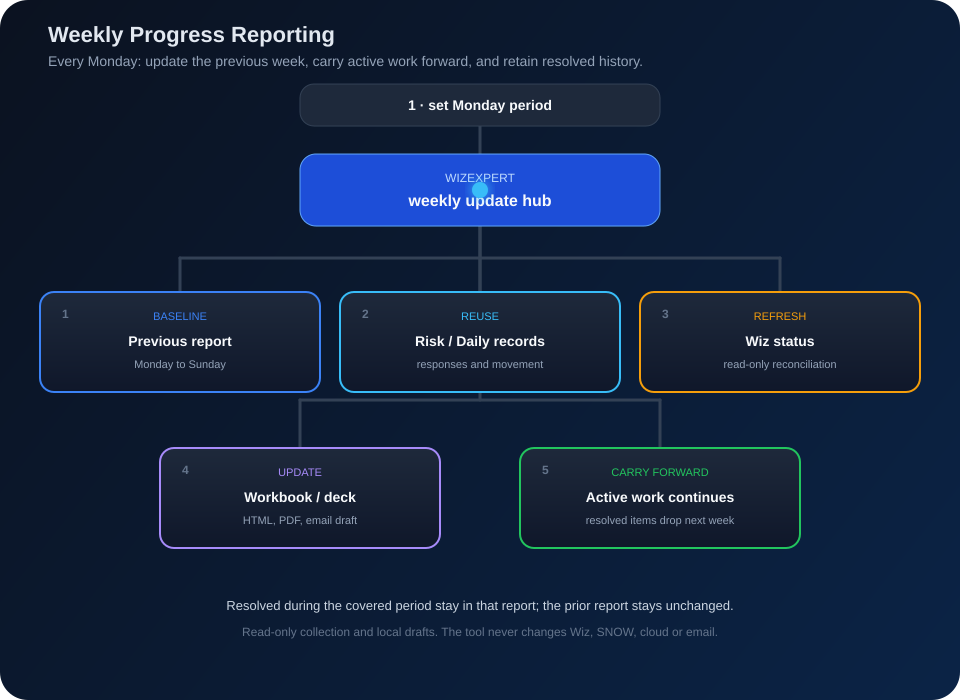

<div align="center">


**Evidence-led Wiz investigation and client reporting.**

Analyze. Communicate. Remediate. Validate. Update.
Read-only Wiz evidence in, reviewed reports out — a person approves everything that leaves.


**[Beats](#risk-issues-in-seven-beats) · [Why](#why-wizexpert) · [What's new](#whats-new) · [Categories](#reporting-categories) · [Quick start](#quick-start) · [Console](#workflow-console) · [Governance](#monthly-governance) · [Guides](#guides)**



<sub>Open the SVG in a browser if GitHub shows a still frame. WizExpert is the hub — the ball returns after every stage. Pass A: remediate → validate → update. Pass B: risk acceptance → update.</sub>

</div>

WizExpert is an **independent** reporting assistant for Wiz, not an official Wiz product.
You describe a reporting scope; authorized **Wiz MCP** tools collect evidence; local tools
turn that into reviewed reports.

> [!IMPORTANT]
> **Nothing is sent, published or changed in Wiz or cloud without a person approving it;**
> only local drafts may be refreshed automatically. Wiz MCP is read-only, the tool never sends
> email, and it never changes Wiz, ticketing or cloud resources.

## Risk Issues, in seven beats

1. **Collect.** Read-only Wiz MCP queries, with gaps recorded.
2. **Draft.** Analysis, spreadsheet and email — in a **private folder outside this repo**.
3. **Communicate.** A person sends the package. The tool never sends.
4. **Approval.** Receive the response. Remediate, or **risk acceptance** skips to update.
5. **Remediate.** Coordinate the fix. The tool does not change cloud.
6. **Validate.** Fresh Wiz evidence.
7. **Update.** Refresh the reports and drafts. Always last.

You don't wire tools together. Open a chat with the `WizExpert` agent and ask.

## Why WizExpert

| ❌ Manual reporting | ✅ With WizExpert |
|---|---|
| Copy-paste from the Wiz portal into spreadsheets | Read-only MCP collection with a retained, hashed evidence snapshot |
| Every report looks different | Fixed deliverable slots, template builders and validators per category |
| "What changed since last time?" is guesswork | **Refresh** computes a delta vs retained evidence and writes a change summary |
| Each new teammate rebuilds the Wiz connection | `.vscode/mcp.json` ships in the repo — clone, sign in with SSO, done |
| Drafts accidentally sent or overwritten | No send, no mutate; previous versions archived before any update |
| Client data creeps into Git | Publication guard and CI keep evidence and reports out of the repo |

## What's new

### 🔌 Wiz MCP ready on clone

The repo ships [`.vscode/mcp.json`](.vscode/mcp.json) registering the Wiz MCP server
(`https://mcp.app.wiz.io`). Open the folder in VS Code, start the `wiz` server, and sign in
through your organization's SSO with **your own** credentials. No tokens or secrets are stored
in the repo. Details: [docs/SETUP.md](docs/SETUP.md).

### 🔄 Ungated status sync, in two visible phases

Status sync no longer waits for an approval click. **Phase 1** checks Wiz status per Risk
Issues case; **Phase 2** runs Refresh plus deliverables only for changed cases, one at a time.
Both phases show in a strip under the console topbar and in notifications.

### 📄 PDF change summary

Every Refresh produces a PDF change summary alongside the new evidence snapshot, so the
"what moved" story is ready to attach.

### ✉️ Four-stage Risk Issues email lifecycle

| Stage | File | When |
|---|---|---|
| Email-1 | `{rule}-Email-1-InitialStakeholder.html` | Work starts on an issue rule |
| Email-2 | `{rule}-Email-2-StatusUpdateRequest.html` | Ask for status on the previous communication |
| Email-3 | `{rule}-Email-3-Refresh.html` | New findings: confirm approach or approve the change, offer help |
| Email-4 | `{rule}-Email-4-FollowUpResponse.html` | Draft a reply to the stakeholder's response |

All drafts are built from templates and never sent by the tool.

## Reporting categories

Every run selects one category and follows its fixed slots:
**category → deliverable slots → builder → validator → workflow QA/review**.

| Category | Fixed deliverables |
|---|---|
| 🛡️ **Risk Issues** | Internal Analysis · Client Assessment · Stakeholder Emails 1–4 · Detailed Report · Updated Detailed Report · PDF change summary |
| 📅 **Daily Progress** | Daily Progress Report · Day-to-Day Movements · VM/CVE Details · Stakeholder Reply |
| 🗓️ **Weekly Progress** | Excel Workbook · Slide Deck · HTML · PDF · Email Draft (in-progress items plus resolved since the previous Monday) |
| 📊 **Monthly Governance** | Governance Workbook · Slide Deck · Executive Dashboard |

<details>
<summary><b>Category workflows (animated)</b></summary>



<sub>Daily Progress. Still open → collect again. Gate met → update and close.</sub>



<sub>Weekly Progress. Previous report → reuse records → refresh status → update → carry forward.</sub>



<sub>Monthly Governance. Cutoff → collect → draft → handoff → retain history → next month.</sub>

</details>

Changes to a category or template need an owner-requested change record, version bump,
template re-pinning and a QA rerun. Campaigns: [docs/CAMPAIGNS.md](docs/CAMPAIGNS.md).

## Quick start

Python 3.12+ and VS Code with GitHub Copilot agent mode.

```powershell
git clone https://github.com/PrashantAHD/WizExpert.git
Set-Location .\WizExpert
python -m venv .venv
.\.venv\Scripts\python.exe -m pip install -e ".[governance]"   # omit [governance] if not needed
.\.venv\Scripts\wizexpert.exe --help
```

1. **Open the folder in VS Code.** The `wiz` MCP server is already configured.
2. **Sign in.** Start the server, complete your organization's SSO and Wiz sign-in in the browser.
3. **Check access.** Ask the agent to list read-only Wiz tools and run a small scoped query.
4. **Pick a private output folder** outside this repository.

Then ask, for example:

> Prepare today's progress report for `<CVE-list>` in `<approved-scope>`. Use fresh Wiz
> evidence, keep previous observations and separate remaining from resolved findings. Do not send it.

## Workflow console

A local frontend for the VS Code agent chat — it adds no workflow rules of its own.

```powershell
wizexpert console install-helper --code <path to code.cmd>   # once, then "Developer: Reload Window"
wizexpert console --workspace <workspace folder>             # http://127.0.0.1:8765/
```

Pick a category, enter its input, press Start: the console opens a **new agent-mode chat** with
the `WizExpert` agent and mirrors it (progress, "input needed", summary, files).

| Feature | What it does |
|---|---|
| 🗂️ **Category cards** | Each private case or campaign folder is a card grouped by category |
| 🔄 **Refresh** | Latest read-only Wiz status → delta → new snapshot, change summary (incl. PDF) → regenerated deliverables |
| ✏️ **Update deliverables** | Owner free text saved verbatim and applied to the latest deliverables (archived first); no Wiz fetch |
| 📡 **Status sync** | Ungated Phase 1 check + Phase 2 refresh of changed cases, one at a time |
| ✅ **Completion checklist** | Per-run workflow checklist so finished runs show what was done |
| 🔔 **Notifications** | Unread badge, mark-all-read, links to each run with its phase/action |
| 🏁 **Resolved stage** | Fully resolved cases move to Resolved with rule title, rule ID and resolution notes |
| 🧑 **Profile avatar** | Initials or optional photo (PNG/JPEG ≤ 1 MB), stored outside the repo |
| 🔐 **Approval gates** | Weekly/Monthly runs and Weekly Update still need explicit approval |

Full reference: [docs/CONSOLE.md](docs/CONSOLE.md).

## Monthly governance

**One tool, any client: each client's rules live in a private profile.**

```powershell
wizexpert governance setup      # once per client
wizexpert governance monthly --month 2026-10 --input <csv...> `
  --previous-report <last workbook> --template <last dashboard> --output-dir <private folder>
```

| Command | Builds |
|---|---|
| `governance monthly` | Workbook + executive dashboard |
| `governance workbook` / `dashboard` / `deck` | Pieces on their own |
| `governance verify` | Read-only replay of the four-severity set |

Runbook: [docs/GOVERNANCE-RUNBOOK.md](docs/GOVERNANCE-RUNBOOK.md). Automated verification does not replace release review.

## Guardrails worth knowing

- **Client names, evidence and reports never live in this repository.**
- **No credentials in the repo.** `.vscode/mcp.json` holds only the server URL; each user authenticates with their own SSO.
- Hostile files: `defusedxml`; Excel values as text; no silent overwrites; SHA-256 on templates.
- CI: publication guard, tests, Bandit, Ruff, `pip-audit`. `main` is PR-only.
- AI analysis is not proof of compromise; a Wiz resolution is not proof of a successful fix. Review every deliverable.
- Found a security issue? Report it privately to the maintainer.

## Guides

| Guide | Covers |
|---|---|
| [Setup](docs/SETUP.md) | Wiz MCP sign-in, install |
| [Workflow QA](docs/WORKFLOW-QA.md) | Evidence-bound QA, Refresh and Update rules |
| [Campaigns](docs/CAMPAIGNS.md) | Repeated fixed-scope collection |
| [Governance](docs/GOVERNANCE.md) | Profiles, workbook, dashboard, deck |
| [Workflow console](docs/CONSOLE.md) | Local frontend that starts and mirrors an agent chat |
| [Publication](docs/PUBLICATION.md) | Verification and pre-push checks |

## License

[MIT](LICENSE) © 2026 Prashant Kumar

---

<div align="center">

**[Prashant Kumar](https://github.com/PrashantAHD)** · Cloud Security Engineer @AHEAD

**Evidence before conclusions. Approval before changes. Verification before closure.**

<sub>WizExpert is independent and isn't affiliated with Wiz, AWS or Microsoft.</sub>

</div>
