<div align="center">


**Evidence-led Wiz investigation and client reporting.**

Analyze. Communicate. Remediate. Validate. Update.




<sub>Risk Issues. Open in a browser if GitHub shows a still frame. WizExpert is the hub — the ball returns after every stage. Pass A: remediate → validate → update. Pass B: risk acceptance → update.</sub>

</div>

WizExpert is an **independent** reporting assistant for Wiz, not an official Wiz product.
You describe a reporting scope; authorized **Wiz MCP** tools collect evidence;
local tools turn that into reviewed reports.

**Nothing is changed, sent or published without a person approving it.**

> [!IMPORTANT]
> Wiz MCP runs in your assistant environment, not in this repository. Installing
> WizExpert does not create a Wiz connection or an unattended service.

> [!NOTE]
> The Risk Issues (wiz-issue-rule-id) workflow is being rebuilt.

## Risk Issues, in beats

Every stage goes out from **WizExpert** and back. The tool is the hub, not a one-way pipeline.

1. **Collect.** Read-only MCP queries and gaps.
2. **Draft.** Analysis, spreadsheet and email — in a **private folder outside this repo**.
3. **Communicate.** A person sends the package. The tool never sends.
4. **Approval.** Receive the response. Then either remediate, or **risk acceptance** skips to update.
5. **Remediate.** Coordinate the fix. The tool does not change cloud. Skipped on risk acceptance.
6. **Validate.** Fresh Wiz evidence. Skipped on risk acceptance.
7. **Update.** Refresh the reports / draft. This is always last.

## What you get

| Deliverable | Purpose |
|---|---|
| Campaign reporting | Fixed-scope Excel, email drafts and progress history |
| Progress / verification history | Cutoffs, decisions, blockers, retained evidence |
| Monthly governance | Per-client workbook, executive dashboard, call deck |
| Workflow QA | Coverage checks — not a substitute for review |

Campaigns (repeated fixed-scope work): [docs/CAMPAIGNS.md](docs/CAMPAIGNS.md). Workflow QA: [docs/WORKFLOW-QA.md](docs/WORKFLOW-QA.md).

## Reusable reporting categories

Every new run selects one category and follows its fixed deliverable slots,
builders, validators and workflow-QA/review gates. Bespoke or legacy
generation logic is not used.

| Category | Fixed deliverables |
|---|---|
| **Risk Issues** | Internal Analysis; Client Assessment; Stakeholder Email; Detailed Report; Internal Follow-up Email; Updated Detailed Report |
| **Daily Progress Reporting** | Daily Progress Report; Day-to-Day Movements; VM/CVE Details; Stakeholder Reply Email |
| **Monthly Governance Reporting** | Monthly Governance Workbook; Monthly Governance Slide Deck; Executive Dashboard |

Each category has its own loop. Open the SVG in a browser if GitHub shows a still frame.



<sub>Daily Progress Reporting. Still open → collect again. Gate met → update and close.</sub>



<sub>Monthly Governance Reporting. Cutoff → collect → draft → handoff → retain history → next month.</sub>

The execution sequence is:
**category selection → fixed deliverable slots → deliverable builder →
deliverable validator → workflow QA/review**.

Changes to a category or template require an owner-requested change record,
version bump, template re-pinning and QA rerun. Client evidence and completed
reports remain in private storage outside this repository.

## Setup

1. Connect your approved assistant to **Wiz MCP** with read-only permissions — [setup guide](docs/SETUP.md).
2. Install local tools (Python 3.12+):

```powershell
git clone https://github.com/PrashantAHD/WizExpert.git
Set-Location .\WizExpert
python -m venv .venv
.\.venv\Scripts\python.exe -m pip install -e ".[governance]"   # omit [governance] if you don't need it
.\.venv\Scripts\wizexpert.exe --help
```

3. Ask the assistant to list read-only Wiz tools and run a small scoped query.
4. Pick a **private output folder** outside this repository.

## Use it

These are assistant requests, not CLI commands. Recurring reports run on demand; nothing is scheduled automatically.

> Prepare today's progress report for `<CVE-list>` in `<approved-scope>`. Use
> fresh Wiz evidence, keep previous observations and separate remaining from
> resolved findings. Do not send it.

## Monthly governance

**One tool, any client: each client's rules live in a private profile.**

```powershell
wizexpert governance setup      # once per client
wizexpert governance monthly --month 2026-10 --input <csv...> `
  --previous-report <last workbook> --template <last dashboard> --output-dir <private folder>
```

| Command | Builds |
|---|---|
| `governance monthly` | Workbook + executive dashboard |
| `governance workbook` / `dashboard` / `deck` | Pieces on their own |
| `governance verify` | Read-only replay of the four-severity set |

Runbook: [docs/GOVERNANCE-RUNBOOK.md](docs/GOVERNANCE-RUNBOOK.md). Automated verification does not replace release review.

## Guardrails worth knowing

- Client names, evidence and reports **never live in this repository**.
- Hostile files: `defusedxml`; Excel values as text; no silent overwrites; SHA-256 on templates.
- CI: publication guard, tests, Bandit, Ruff, `pip-audit`. `main` is PR-only.
- Review every deliverable before sharing. AI analysis is not proof of compromise; a Wiz resolution is not proof of a successful fix.
- Found a security issue? Report it privately to the maintainer.

## Guides

| Guide | Covers |
|---|---|
| [Setup](docs/SETUP.md) | Wiz MCP, install |
| [Workflow QA](docs/WORKFLOW-QA.md) | Evidence-bound QA reviews |
| [Campaigns](docs/CAMPAIGNS.md) | Repeated fixed-scope collection |
| [Governance](docs/GOVERNANCE.md) | Profiles, workbook, dashboard, deck |
| [Publication](docs/PUBLICATION.md) | Verification and pre-push checks |

## License

[MIT](LICENSE) © 2026 Prashant Kumar

---

<div align="center">

**[Prashant Kumar](https://github.com/PrashantAHD)** · Cloud Security Engineer @AHEAD

**Evidence before conclusions. Approval before changes. Verification before closure.**

<sub>WizExpert is independent and isn't affiliated with Wiz, AWS or Microsoft.</sub>

</div>
